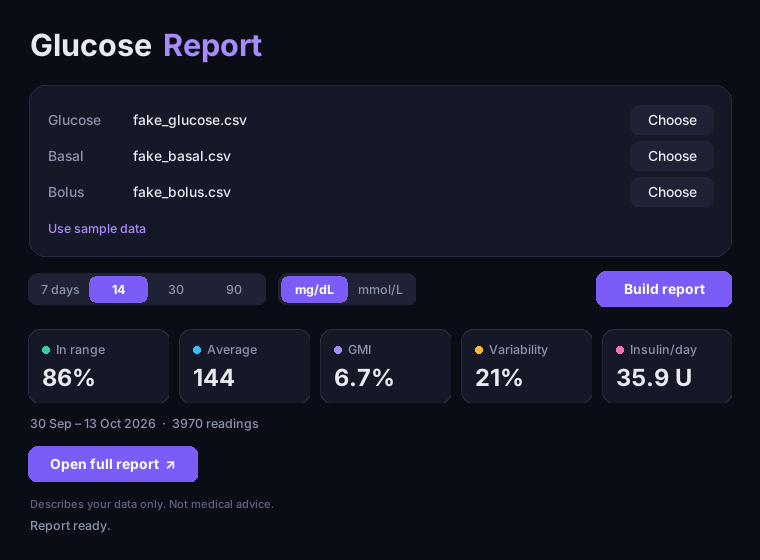
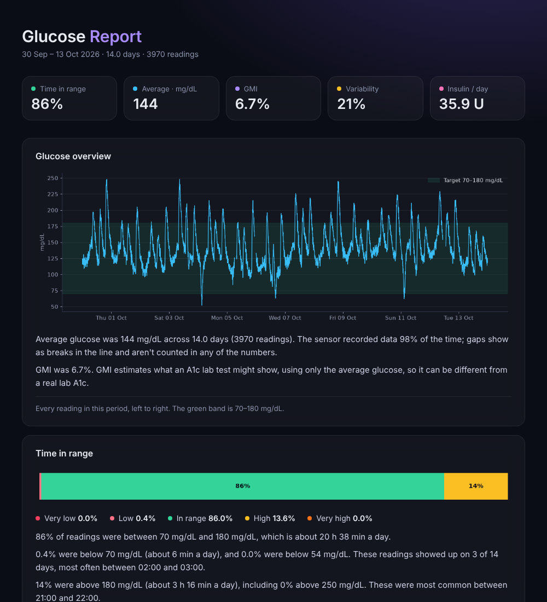
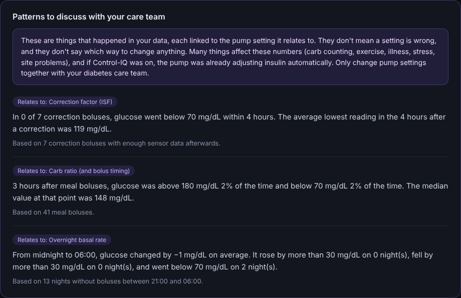

# glucose-report

Turn CGM and insulin pump exports into a clean, easy-to-read glucose report: key numbers, graphs,
plain-language explanations, and patterns worth bringing to your diabetes care team.

Made with **Tandem t:slim X2** users in mind, but it works with any CSV export that has
timestamps and glucose values (Dexcom Clarity, Libre, Tandem, Glooko…).

> ⚠️ **For personal insight only. Not medical advice.**
> This tool describes your data. It never tells you to change insulin or pump settings.
> Always make treatment decisions together with your diabetes care team.



---

## What it does

**A simple desktop app.** Choose your files, pick a period (7 / 14 / 30 / 90 days) and units
(mg/dL or mmol/L), click **Build report**, and see the key numbers straight away.

**A full report in your browser**, with:

| Section | What it shows |
|---|---|
| **Key numbers** | Time in range, average glucose, GMI (estimated A1c), variability (CV), insulin per day |
| **Glucose overview** | Every reading in the period, with the 70–180 mg/dL target band |
| **Time in range** | How much time was very low, low, in range, high and very high |
| **Typical day (AGP)** | All days stacked by time of day, showing the median and how much readings varied |
| **Day by day** | Glucose with basal rate and boluses underneath, one row per day |

Every graph has a short plain-language note underneath explaining what the data shows,
for example *"85% of readings were between 70 and 180 mg/dL, which is about 20 h 27 min a day."*



### Patterns to discuss with your care team

At the bottom of the report, the tool looks for patterns and links each one to the pump setting
it relates to:

- **After correction boluses** → relates to the *correction factor (ISF)*
- **After meal boluses** → relates to the *carb ratio (and bolus timing)*
- **Overnight, with no boluses** → relates to the *overnight basal rate*

It only reports what happened. It does **not** say whether a setting is wrong or which way to change it.
A pattern only appears when there are at least 3 examples of it.



*(All screenshots use fake sample data.)*

---

## Getting started

### 1. Install

You need [Python 3.10+](https://www.python.org/downloads/). Then, in a terminal inside the project folder:

```bash
pip install -r requirements.txt
```

On Windows, if `pip` isn't found, use `py -m pip install -r requirements.txt`.

### 2. Run the app

```bash
python src/app.py
```

Or open `src/app.py` in **Spyder** and press **F5**.

### 3. Try it with sample data

Click **Use sample data**, then **Build report**, then **Open full report**.
This makes 14 days of realistic fake data, so you can see everything without using real health data.

---

## Using your own data

1. Export your data as CSV files:
   - **Glucose:** from Dexcom Clarity, LibreView, Tandem Source or Glooko
   - **Basal and boluses (optional):** from Tandem Source or Glooko
2. Put the files in a `data/` folder inside the project (create it if it isn't there yet).
   Anything in `data/` is never uploaded to GitHub.
3. In the app, click **Choose** next to each file, then **Build report**.

**Good to know**

- The tool recognises common column names automatically. If it can't read a file, it shows the
  column names it found. Add them to the lists at the top of `src/load.py`.
- mmol/L files are converted automatically, and "Low" / "High" readings are handled.
- The meal and correction patterns need a bolus file with a **carbs** or **bolus type** column,
  so the tool can tell them apart. Without one, you still get everything else.

### Without the app (command line)

```bash
python src/report.py --glucose data/my_cgm.csv
python src/report.py --glucose data/my_cgm.csv --basal data/basal.csv --bolus data/bolus.csv
python src/report.py --glucose data/my_cgm.csv --days 30 --units mmol
```

The report is saved to `reports/report.html`.

---

## Privacy

Your data stays on your computer. The `data/` and `reports/` folders are listed in `.gitignore`,
so health data is **never uploaded to GitHub**. Only the code is public.

---

## Project structure

```
glucose-report/
├── src/
│   ├── app.py              # the desktop app
│   ├── load.py             # reads and cleans CSV exports
│   ├── stats.py            # numbers, plain-language notes and care-team patterns
│   ├── plots.py            # all the graphs
│   ├── report.py           # builds the HTML report
│   └── make_fake_data.py   # creates realistic sample data
├── docs/                   # screenshots for this README
├── requirements.txt
└── README.md
```

---

## About

A learning project, built step by step with AI-assisted coding ("vibe coding") using Python,
pandas, matplotlib and tkinter. Suggestions and issues are welcome.

**Not a medical device.** Not affiliated with Tandem Diabetes Care, Dexcom, Abbott or Glooko.
